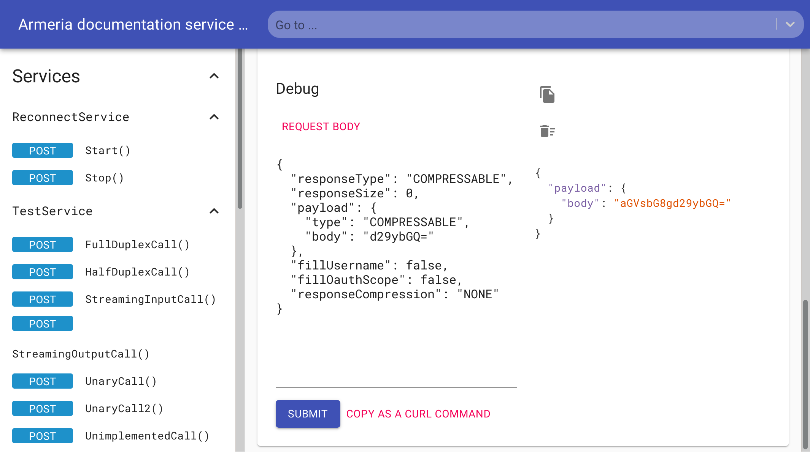

팀에서 운영하는 서비스 중 작년 7월에 Spring Boot 버전을 3.2로 올린 서비스가 있었습니다.
이후 약 15개월간 버전 업그레이드와 관련된 큰 이슈 없이 운영해 왔는데 지난 주 평일 새벽에 k8s 워커 노드가 scale-in 되는 과정에서 해당 서비스의 pod이 재배치되는 과정에서 이슈가 발생했습니다.
재배치된 pod 중 하나에서 특정 Jar의 클래스를 로딩하지 못해 ClassNotFoundException이 발생하며 관련 요청이 모두 실패하였는데요. 해당 pod을 재기동한 이후에는 ClassNotFoundException이 발생하지 않았습니다.

해당 이슈의 원인을 추적하는 과정에서 Armeria의 DocService와 Spring Boot 클래스 로더 사이의 TOCTOU 이슈가 유력한 원인으로 보여 upstream에 [수정 PR](https://github.com/line/armeria/pull/7057)을 올렸고 현재 머지되었습니다.

Armeria의 [DocService](https://armeria.dev/docs/server/docservice/)는 gRPC의 RPC와 요청이나 응답 메시지 명세를 웹에서 확인하고 RPC를 직접 호출해볼 수 있는 기능입니다.

*DocService의 gRPC 호출 화면. [이미지 출처: Armeria 공식 저장소](https://github.com/line/armeria/blob/main/site/static/img/docservice-carousel-2.png)*

Spring Boot 3.2부터 새롭게 도입된 클래스 로더에는 Shared JarFile Instance를 캐싱하는 로직이 존재합니다.

일반적인 경우 Shared JarFile이 캐싱되어 있다면 이후 해당 JarFile이 close될 때 캐시에서 제거하는 콜백 로직이 존재합니다.

다만 Spring Boot 클래스 로더가 Shared JarFile을 캐시에 등록하기 직전 등록하려는 JarFile이 close된다면 콜백 로직이 아무런 동작도 하지 않을 수 있습니다. 이 경우 close된 상태로 캐시에 남게 될 수 있습니다.

Armeria의 DocService는 클래스 스캐닝을 위해 Reflections 라이브러리를 사용하는데 이 과정에서 Shared JarFile을 읽고 close하는 동작이 Spring Boot 클래스 로더 캐싱 로직과 충돌할 수 있었습니다.

이 경우 JVM 재기동 전까지 해당 JarFile에 포함된 클래스를 로딩하지 못하고 ClassNotFoundException이 발생할 수 있습니다.

<iframe src="/post-visualizations/shared-jarfile-lifecycle.html" title="Shared JarFile 캐싱의 정상 흐름, TOCTOU 경합, 수정 후 흐름 비교" width="100%" height="840" loading="lazy" style="display: block; width: 100%; border: 0; margin: 28px 0;"></iframe>

PR에서는 Reflections 라이브러리의 버전을 올려 DocService에서 클래스 스캐닝 시 Shared JarFile 대신 별도의 JarFile Instance를 사용하도록 수정해두었습니다.

Spring Boot 3.2.0 ~ 4.1.x 버전과 Armeria의 DocService를 함께 사용하는 환경에서 ClassNotFoundException이 발생한 적이 있으시다면 위 이슈와 관련이 있을 수도 있습니다.

포스팅 시점에는 아직 수정사항이 포함된 버전이 릴리즈되지 않았습니다.
Workaround로는 DocService를 비활성화하거나 Spring Boot 3.x 버전을 사용하시는 경우 CLASSIC 클래스 로더(3.2 이전 방식이고 4에서 제거됨)를 사용하도록 변경하는 방법이 있으니 참고 부탁드립니다.
